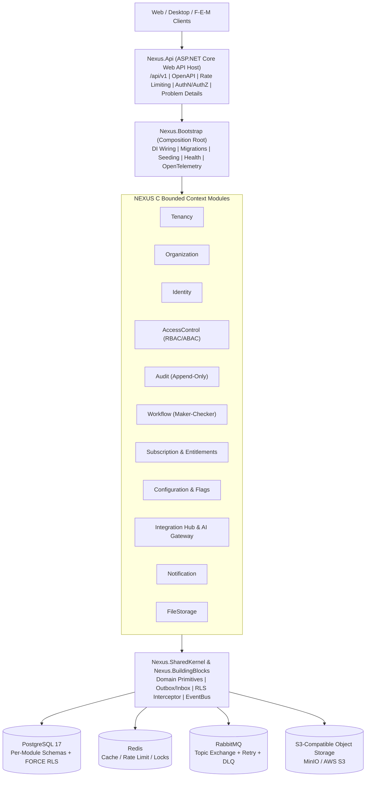

# NEXUS C — Foundation Architecture Blueprint

**Version:** 1.0  
**Status:** Approved for Foundation Implementation  
**Architecture Style:** Modular Monolith (Domain-Isolated, Multi-Tenant SaaS)  
**Target Ecosystem:** NEXUS C (Center), preparing explicit integration boundaries for NEXUS F (Finance), NEXUS E (Express), and NEXUS M (Management).

---

## 1. Architectural Vision

NEXUS C (Center) is the authoritative technical and governance backbone of the NEXUS Ecosystem. It provides multi-tenancy, organizational structure, identity, fine-grained RBAC/ABAC-ready authorization, immutable auditing, approval workflows, SaaS subscriptions/entitlements, versioned configuration, reliable messaging (Transactional Outbox/Inbox + RabbitMQ), integration connectors, notifications, tenant-isolated file storage, and an AI Gateway control plane.

Future ecosystem products (**NEXUS F**, **NEXUS E**, **NEXUS M**) will consume NEXUS C capabilities via:
1. **Stable REST APIs** under `/api/v1/platform/...`
2. **Versioned Domain Integration Events** via RabbitMQ using the canonical `EventEnvelope`
3. **In-process Module Contracts** when co-hosted within the Modular Monolith prior to any future service extraction.

---

## 2. High-Level System Architecture

---

## 3. Architectural Layers & Dependency Rules

Every module follows Clean Architecture selectively (no unnecessary ceremony):

| Layer | Responsibility | Allowed Dependencies |
|---|---|---|
| `Domain` | Entities, Value Objects, Domain Rules, Domain Events | `Nexus.SharedKernel` only |
| `Contracts` | Public DTOs, Integration Events, Cross-Module Query Interfaces | `Nexus.SharedKernel` |
| `Application` | Use Cases / Application Services, Validators, Orchestration | `Domain`, `Contracts`, `Nexus.SharedKernel`, `Nexus.BuildingBlocks` |
| `Infrastructure` | Module `DbContext`, EF Configurations, Migrations, External Adapters | `Domain`, `Application`, `Nexus.BuildingBlocks` |
| `Nexus.Api` | Thin HTTP Controllers, OpenAPI, Middleware, Policies | `Nexus.Bootstrap`, Module `Contracts` & Application interfaces |

### Forbidden Dependencies (Enforced by `Nexus.ArchitectureTests`)
- A module MUST NOT reference another module's `Domain` or `Infrastructure` types directly.
- Controllers MUST NOT reference `DbContext` or execute database queries directly.
- `Nexus.SharedKernel` MUST NOT depend on ASP.NET Core, EF Core, Npgsql, or RabbitMQ.
- Static mutable business state is strictly prohibited.

---

## 4. Multi-Tenant Defense-in-Depth Architecture

Tenant isolation is enforced simultaneously at **three independent layers**:

1. **Authentication & Trusted Context Resolution (`TenantContextMiddleware`)**:
   - The server NEVER trusts client-supplied tenant IDs in request bodies or query parameters as authorization proof.
   - Authenticated users receive a signed JWT containing `sub` (UserId), `tid` (active TenantId validated against `tenancy.user_tenant_memberships`), `sid` (SessionId), and `scope` (`platform` or `tenant`).
   - Tenant switching requires an explicit authenticated membership check and mints a tenant-bound token.
   - Suspended tenants are blocked from standard business operations at the middleware/policy boundary.

2. **Application Layer (EF Core Global Query Filters)**:
   - Every `TenantScopedEntity` has an automatic EF Core global query filter bound to `ITenantContext.TenantId`.
   - `ModuleDbContextBase.SaveChangesAsync` enforces `TenantId` assignment and rejects any cross-tenant mutation attempt before SQL is sent.

3. **Database Layer (PostgreSQL Row-Level Security — `FORCE ROW LEVEL SECURITY`)**:
   - The application connects using the least-privilege role `nexus_app` (`NOSUPERUSER NOBYPASSRLS`).
   - Every database transaction/command sets `app.current_tenant_id` via `set_config(..., is_local => true)`.
   - Policies are **fail-closed**: if `app.current_tenant_id` is missing and `app.bypass_rls` is not `'on'`, PostgreSQL returns 0 rows and denies writes.
   - Cross-tenant Platform Administration operations explicitly invoke a scoped `PlatformElevatedContext` which requires Platform-scoped permissions AND emits a mandatory immutable Audit record with actor, reason, and target tenant.

---

## 5. Reliability & Event-Driven Architecture

- **Transactional Outbox**: Domain state changes and `messaging.outbox_messages` rows commit in the same PostgreSQL ACID transaction.
- **Background Dispatcher**: `OutboxProcessorBackgroundService` claims pending messages using `FOR UPDATE SKIP LOCKED`, publishes to RabbitMQ with `eventId`, `correlationId`, `tenantId`, and `schemaVersion`, and tracks retries with exponential backoff before routing permanent failures to `messaging.dead_letter_messages` and the RabbitMQ DLQ.
- **Idempotent Inbox**: Consumers record `(event_id, consumer_name)` in `messaging.inbox_messages` with a unique constraint inside the processing transaction so duplicate deliveries never create duplicate side effects.
- **HTTP Idempotency**: Sensitive mutating endpoints support the `Idempotency-Key` header backed by `messaging.idempotency_records` with request hash verification and concurrent-request locking.

---

## 6. Observability & Operations

- **Structured Logging**: Serilog JSON structured logs enriched with `CorrelationId`, `TenantId`, `UserId`, and automatic redaction of credentials, tokens, and secrets.
- **OpenTelemetry**: Distributed tracing (ASP.NET Core, HTTP, Npgsql) and metrics exported via OTLP (configurable).
- **Health Checks**:
  - `GET /health/live` — Process liveness probe (zero external dependency blocking).
  - `GET /health/ready` — Readiness probe verifying PostgreSQL (and optional Redis/RabbitMQ when enabled).
- **Graceful Shutdown**: Host drains in-flight requests and cancels background workers via `CancellationToken`.
