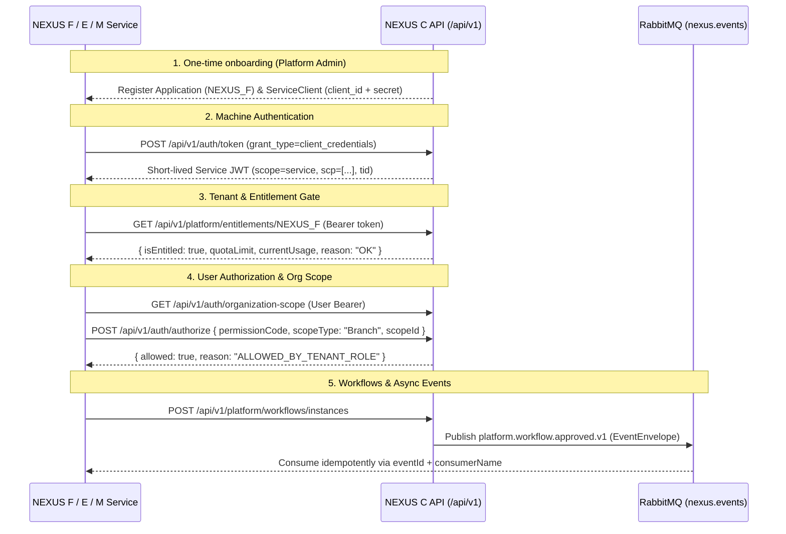

# NEXUS Ecosystem Integration Guide (NEXUS F / E / M)

This guide defines the authoritative onboarding and runtime integration lifecycle for member applications (**NEXUS F — Finance**, **NEXUS E — Express**, **NEXUS M — Management**) consuming **NEXUS C 1.0**.

---

## 1. End-to-End Integration Lifecycle

---

## 2. Step-by-Step Onboarding Checklist

### Step 1: Register Application Compatibility Metadata
`NEXUS_C`, `NEXUS_F`, `NEXUS_E`, and `NEXUS_M` are pre-seeded in `subscription.applications`. Applications update their release version and compatibility metadata via:
- `PUT /api/v1/platform/applications/{code}` (`platform.applications.manage`)

### Step 2: Provision Machine Identity (OAuth 2.0 Client Credentials)
Platform Admin registers a dedicated least-privilege `ServiceClient` per application:
- `POST /api/v1/platform/api-clients`
  - Example for Finance: `clientId: "nexus-f-service"`, `applicationCode: "NEXUS_F"`, `allowedScopes: ["platform.organizations.read", "platform.subscriptions.read", "platform.workflows.create", "platform.workflows.read", "platform.files.upload", "platform.files.read", "platform.notifications.manage"]`.
- Store the one-time `clientSecret` strictly in your secret vault (never in Git or source config). Rotate periodically via `POST /api/v1/platform/api-clients/{id}/rotate-secret`.

### Step 3: Authenticate Service & End-User Requests
- **Service-to-Platform calls:** Exchange `client_id` + `client_secret` at `POST /api/v1/auth/token` for a 10-minute Bearer JWT (`scope=service`). Cache until ~60 seconds before expiry.
- **End-User calls:** Validate the user's NEXUS C JWT (same `Issuer`, `Audience`, signing key) and forward `Authorization: Bearer <userJwt>` + `X-Correlation-Id` when calling user-context endpoints (`/api/v1/auth/permissions`, `/api/v1/auth/organization-scope`, `/api/v1/auth/authorize`).

### Step 4: Enforce Tenant Context & Entitlements
- Always derive `tenantId` from the verified JWT `tid` claim (never trust unverified client query/body tenant IDs).
- Before executing product features, call `GET /api/v1/platform/entitlements/{appOrFeatureCode}`:
  - Deny access when `isEntitled == false` and surface `reason` (`NO_ACTIVE_SUBSCRIPTION`, `SUBSCRIPTION_SUSPENDED`, `APPLICATION_DEACTIVATED`, `FEATURE_FLAG_DISABLED`, `QUOTA_EXCEEDED`).
- Report metered usage with deterministic `IdempotencyKey` via `POST /api/v1/platform/subscriptions/usage`.

### Step 5: Enforce Organization Scope & Policy Authorization
- Resolve effective organizational boundaries (`legalEntityIds`, `branchIds`, `organizationUnitIds`) via `GET /api/v1/auth/organization-scope`.
- For fine-grained resource/branch actions, invoke `POST /api/v1/auth/authorize` with `{ permissionCode, scopeType, scopeId }`.

### Step 6: Consume Shared Workflow, Files & Notifications
- **Workflows:** Create approval definitions (`POST /api/v1/platform/workflows/definitions`), start instances (`POST /instances`), listen for `platform.workflow.approved.v1` / `rejected.v1` / `cancelled.v1` / `escalated.v1`. Never re-implement approval state machines inside F/E/M.
- **Files:** Upload via `POST /api/v1/platform/files` with optional `retentionDays`; store returned `fileId` in your domain record rather than raw S3 object keys.
- **Notifications:** Use tenant templates (`POST /api/v1/platform/notifications/send`) for In-App, Email, and SSRF-validated Webhook notifications.

### Step 7: Subscribe to Platform Events Idempotently
- Bind an application-specific durable queue to RabbitMQ exchange `nexus.events` with routing keys such as `platform.tenant.#`, `platform.user.#`, `platform.subscription.#`, `platform.workflow.#`.
- Deduplicate every consumed message using `(eventId, consumerName)` inside a local database transaction before applying state transitions.
- Never access NEXUS C PostgreSQL schemas directly.

### Step 8: Participate in Observability & Audit
- Always forward `X-Correlation-Id` and W3C `traceparent` headers across all service-to-service HTTP calls and event envelopes (`correlationId` + `causationId`).
- Query tenant audit history via `GET /api/v1/platform/audit` (read-only); sensitive operations executed through NEXUS C APIs are automatically audited immutably.
